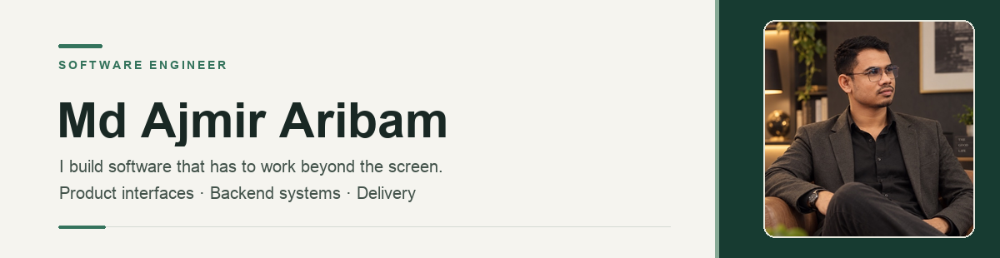
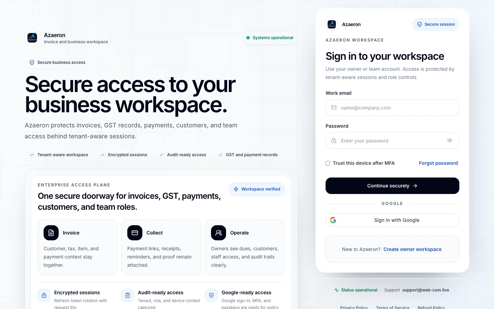
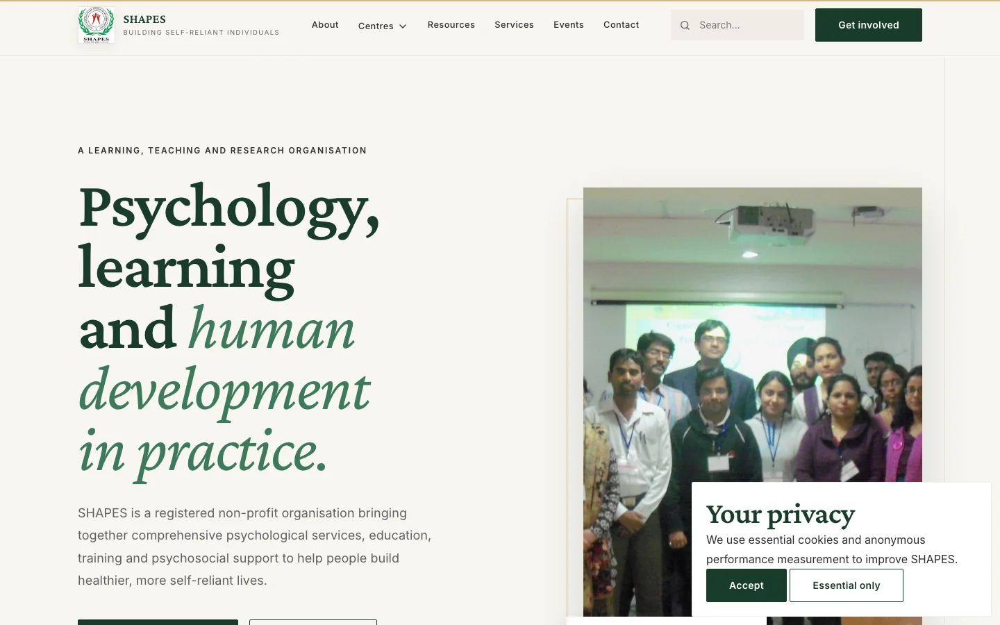
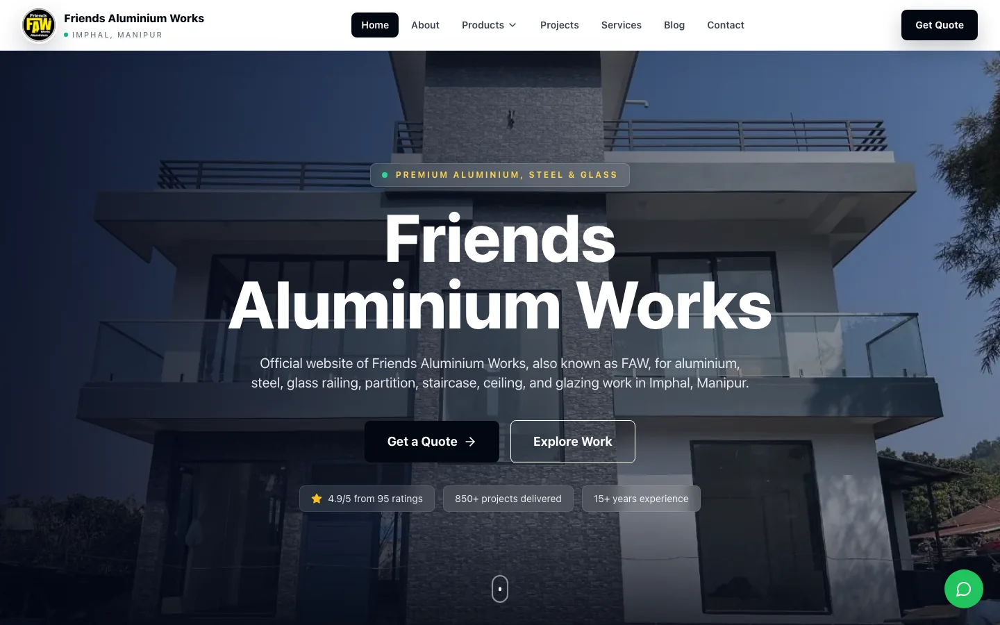
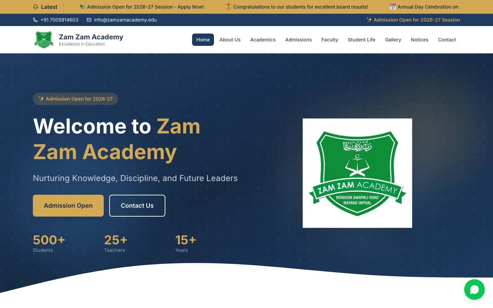

<h1 align="center">Md Ajmir Aribam</h1>

  <strong>Software Engineer · Backend Systems · Full-Stack Products</strong> 
  Imphal, India · MCA, Sharda University (2025–2027)

  <a href="https://ajmiraribam.me/">Portfolio</a> ·
  <a href="https://www.linkedin.com/in/ajmir-aribam/">LinkedIn</a> ·
  <a href="https://ajmiraribam.me/resume">Résumé</a> ·
  <a href="mailto:arajmir7@gmail.com">Email</a>

## Profile at a glance

<table>
  <tr>
    <td align="center"><strong>03</strong> Live websites</td>
    <td align="center"><strong>01</strong> Hosted prototype</td>
    <td align="center"><strong>02</strong> Public engineering systems</td>
  </tr>
</table>

## About

I build dependable software across backend services, web interfaces, and data. I focus on explicit business rules, traceable records, and changes that can be verified. Earlier work in banking and digital public services shaped my attention to accurate records and accountable outcomes.

## Selected work

<table>
  <tr>
    <td width="50%" valign="top">
      
      <h3>01 / Azaeron</h3>
      
<strong>Live billing product · Full-stack engineering</strong>

      
Invoice, quotation, inventory, and customer workflows with API-enforced permissions, lifecycle rules, and audit records. Source is private; the case study describes scope and verification limits.

      
<a href="https://invoice.web-com.live/">Visit site ↗</a> · <a href="https://ajmiraribam.me/work/azaeron">Case study</a>

    </td>
    <td width="50%" valign="top">
      
      <h3>02 / SHAPES India</h3>
      
<strong>Live institutional platform · Application and publishing engineering</strong>

      
A public platform connecting six centres, their programmes, and shared resources.

      
<a href="https://shapesindia.org/">Visit site ↗</a> · <a href="https://ajmiraribam.me/work/shapes-india">Case study</a>

    </td>
  </tr>
  <tr>
    <td width="50%" valign="top">
      
      <h3>03 / Friends Aluminium Works</h3>
      
<strong>Live commercial website · Frontend delivery</strong>

      
A product and project site for an aluminium fabrication business, designed to guide visitors from its work to an enquiry.

      
<a href="https://friendsaluminiumworks.com/">Visit site ↗</a> · <a href="https://ajmiraribam.me/work/friends-aluminium-works">Case study</a>

    </td>
    <td width="50%" valign="top">
      
      <h3>04 / Zam Zam Academy</h3>
      
<strong>Hosted prototype · Web delivery</strong>

      
A multi-page education website study covering academics, admissions, faculty, student life, notices, and contact journeys.

      
<a href="https://storied-bombolone-5d4a8f.netlify.app/">Open preview ↗</a> · <a href="https://ajmiraribam.me/work/zam-zam-academy">Case study</a>

    </td>
  </tr>
</table>

## Engineering projects

<table>
  <tr>
    <td width="50%" valign="top">
      <h3>Azaeron Verity</h3>
      
<strong>Document intelligence · In development · Not production ready</strong>

      
A review workspace that keeps document findings attached to their source and version. It combines tenant-scoped retrieval, asynchronous analysis, and human review. Production model approval and detector calibration remain open.

      
<a href="https://github.com/arajmir7/Azaeron-Verity">Repository</a> · <a href="https://github.com/arajmir7/Azaeron-Verity/blob/main/ARCHITECTURE.md">Architecture</a> · <a href="https://ajmiraribam.me/work/azaeron-verity">Case study</a>

    </td>
    <td width="50%" valign="top">
      <h3>SCMIRN</h3>
      
<strong>Civic-service routing · Prototype · Not production ready</strong>

      
A prototype for finding relevant civic-service routes, with consent checks, versioned rules, and source-verified handoffs. It does not file requests with government agencies.

      
<a href="https://github.com/arajmir7/SCMIRN">Repository</a> · <a href="https://github.com/arajmir7/SCMIRN/tree/main/src/backend/app/source_routing">Routing implementation</a>

    </td>
  </tr>
</table>

## Engineering toolset

### Languages

  &nbsp;
  &nbsp;
  &nbsp;
  &nbsp;
  &nbsp;
  &nbsp;
  

**Python · Java · C · JavaScript · TypeScript · HTML · CSS**

### Frameworks and runtimes

  &nbsp;
  &nbsp;
  &nbsp;
  &nbsp;
  &nbsp;
  &nbsp;
  

**React · Next.js · FastAPI · Flask · Node.js · Express · Vite**

### Data and jobs

  &nbsp;
  &nbsp;
  

**PostgreSQL · SQL · SQLAlchemy · MongoDB · Redis · Celery · MinIO**

### Testing and delivery

  &nbsp;
  &nbsp;
  &nbsp;
  &nbsp;
  

**pytest · Playwright · Vitest · Ruff · axe-core · Git · GitHub Actions · Docker · Vercel**

## Current technical focus

I’m exploring document retrieval, model evaluation, and uncertainty in AI-assisted review. In Verity, these ideas are visible in the [retrieval pipeline](https://github.com/arajmir7/Azaeron-Verity/blob/main/backend/app/modules/similarity/service.py) and [calibration layer](https://github.com/arajmir7/Azaeron-Verity/blob/main/backend/app/modules/detection/intelligence/calibration.py). These remain experiments separate from the production runtime.

---

  <a href="https://ajmiraribam.me/work">More work</a> ·
  <a href="https://ajmiraribam.me/engineering">Engineering approach</a> ·
  <a href="https://github.com/arajmir7/ajmir-aribam-portfolio">Portfolio source</a> ·
  <a href="mailto:arajmir7@gmail.com">Get in touch</a>

