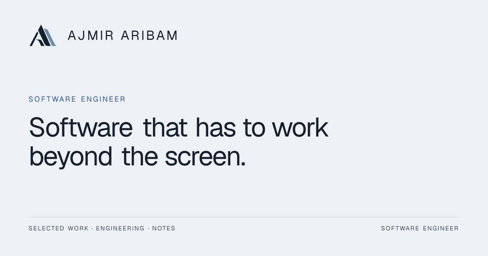

<h1 align="center">Md Ajmir Aribam</h1>

  <strong>Software Engineer · Full-Stack &amp; Backend Systems</strong> 
  Imphal, India · MCA student at Sharda University

  <a href="https://ajmiraribam.me/">Portfolio</a> ·
  <a href="https://www.linkedin.com/in/ajmir-aribam/">LinkedIn</a> ·
  <a href="https://ajmiraribam.me/resume">Résumé</a> ·
  <a href="mailto:arajmir7@gmail.com">Email</a>

## About

I’m a software engineer based in Imphal and an MCA student at Sharda University. I build products from the interface through to the APIs, data, and delivery behind them. Before focusing on software, I worked with banking transactions and public digital-service workflows. That experience still shapes how I work: clear status, accurate records, and useful explanations when something goes wrong.

## How I work

On each project, I start with what a person needs to do. I make the rules explicit, enforce them in the API, and check both the normal path and likely failure cases. I want the next engineer to be able to see why a change was made and what it affected.

## Live websites

You can visit my portfolio and three product websites below. Each case study explains the work I did and what is available to see publicly.

<table>
  <tr>
    <td width="50%" valign="top">
      
      <h3>My portfolio</h3>
      
<strong>Live · Design and full-stack engineering</strong>

      
I built this site to show the work itself, the decisions behind it, and the limits of each project. It brings together case studies, engineering notes, and a way to get in touch.

      
<a href="https://ajmiraribam.me/">Visit the site ↗</a> · <a href="https://github.com/arajmir7/ajmir-aribam-portfolio">View the source</a>

    </td>
    <td width="50%" valign="top">
      
      <h3>Azaeron</h3>
      
<strong>Live · Full-stack engineering</strong>

      
Azaeron brings quotations, invoices, payments, inventory, and customer records into one workspace. I worked on the interface and backend rules: its API checks an allowed invoice transition before saving it, then records the change. The public sign-in is live; the source is private.

      
<a href="https://invoice.web-com.live/">Visit the site ↗</a> · <a href="https://ajmiraribam.me/work/azaeron">Read the case study</a>

    </td>
  </tr>
  <tr>
    <td width="50%" valign="top">
      
      <h3>SHAPES India</h3>
      
<strong>Live · Application and publishing engineering</strong>

      
SHAPES India is a public platform for six centres, their programmes, and shared resources. I worked on the application and publishing system that brings their information together.

      
<a href="https://shapesindia.org/">Visit the site ↗</a> · <a href="https://ajmiraribam.me/work/shapes-india">Read the case study</a>

    </td>
    <td width="50%" valign="top">
      
      <h3>Friends Aluminium Works</h3>
      
<strong>Live · Frontend delivery</strong>

      
The site presents an aluminium fabrication business’s products, projects, and services, with a clear route for prospective customers to enquire. I handled the frontend delivery.

      
<a href="https://friendsaluminiumworks.com/">Visit the site ↗</a> · <a href="https://ajmiraribam.me/work/friends-aluminium-works">Read the case study</a>

    </td>
  </tr>
</table>

## Hosted prototype

### Zam Zam Academy

I built a multi-page education website prototype covering academics, admissions, faculty, student life, notices, and contact. The hosted version is available to explore; it is not the school’s operational site.

[Open the prototype ↗](https://storied-bombolone-5d4a8f.netlify.app/) · [Read the case study](https://ajmiraribam.me/work/zam-zam-academy)

## Engineering projects

<table>
  <tr>
    <td width="50%" valign="top">
      <h3>Azaeron Verity</h3>
      
<strong>Document review · In development · Not production-ready</strong>

      
Findings stay tied to the document version and recorded sources behind them. Reviewers decide whether to accept proposed edits; similarity and authorship signals are shown with their limits. The project is still in development.

      
<a href="https://github.com/arajmir7/Azaeron-Verity">Repository</a> · <a href="https://github.com/arajmir7/Azaeron-Verity/blob/main/ARCHITECTURE.md">Architecture</a> · <a href="https://ajmiraribam.me/work/azaeron-verity">Read the case study</a>

    </td>
    <td width="50%" valign="top">
      <h3>SCMIRN</h3>
      
<strong>Civic-service routing · Prototype · Not production-ready</strong>

      
SCMIRN is a prototype for helping people find relevant public services and reach source-checked official information. It does not submit requests to agencies or act as a government service.

      
<a href="https://github.com/arajmir7/SCMIRN">Repository</a> · <a href="https://github.com/arajmir7/SCMIRN/tree/main/src/backend/app/source_routing">Routing implementation</a>

    </td>
  </tr>
</table>

## Technologies

### Languages and web foundations

  &nbsp;
  &nbsp;
  &nbsp;
  &nbsp;
  &nbsp;
  &nbsp;
  

**Python · Java · C · JavaScript · TypeScript · HTML · CSS**

### Frameworks and runtimes

  &nbsp;
  &nbsp;
  &nbsp;
  &nbsp;
  &nbsp;
  &nbsp;
  

**React · Next.js · FastAPI · Flask · Node.js · Express · Vite**

### Data and background jobs

  &nbsp;
  &nbsp;
  

**PostgreSQL · SQL · SQLAlchemy · MongoDB · Redis · Celery · MinIO**

### Testing and delivery

  &nbsp;
  &nbsp;
  &nbsp;
  &nbsp;
  

**pytest · Playwright · Vitest · Ruff · axe-core · Git · GitHub Actions · Docker · Vercel**

## What I’m exploring

I’m exploring how document review can show the evidence behind a finding without presenting an AI-generated signal as a verdict. In Azaeron Verity, that means keeping each result connected to its source and version, making uncertainty visible, and leaving the decision with the reviewer. This work remains experimental; see the [retrieval pipeline](https://github.com/arajmir7/Azaeron-Verity/blob/main/backend/app/modules/similarity/service.py) and [calibration layer](https://github.com/arajmir7/Azaeron-Verity/blob/main/backend/app/modules/detection/intelligence/calibration.py).

---

  <a href="https://ajmiraribam.me/work">More of my work</a> ·
  <a href="https://ajmiraribam.me/engineering">How I approach engineering</a> ·
  <a href="https://github.com/arajmir7/ajmir-aribam-portfolio">Portfolio source</a> ·
  <a href="mailto:arajmir7@gmail.com">Get in touch</a>

