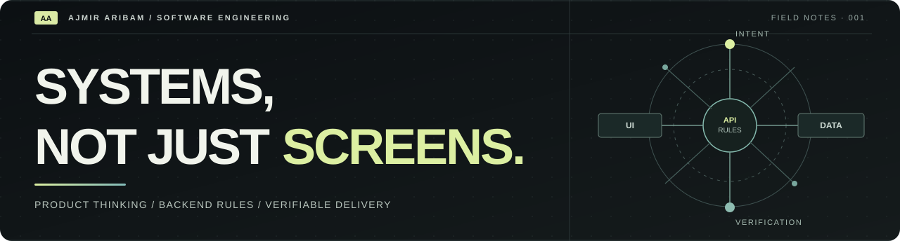
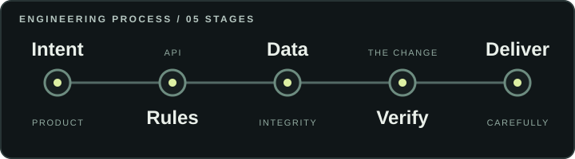

  

<h1 align="center">Ajmir Aribam</h1>

<strong>Software Engineer · Backend Systems · Full-Stack Product Development</strong>

I build applications where the interface, business rules, data, and delivery are designed to work together.

  <a href="https://ajmiraribam.me/">Portfolio</a> &nbsp;·&nbsp;
  <a href="https://github.com/arajmir7?tab=repositories">Source code</a> &nbsp;·&nbsp;
  <a href="https://www.linkedin.com/in/ajmir-aribam/">LinkedIn</a> &nbsp;·&nbsp;
  <a href="https://ajmiraribam.me/resume">Résumé</a> &nbsp;·&nbsp;
  <a href="mailto:arajmir7@gmail.com">Email</a>

---

## About

I work across React and TypeScript interfaces, Python and Node.js services, REST APIs, and database-backed workflows. I am especially interested in making application state explicit, enforcing authorization at the server boundary, protecting data integrity, and verifying meaningful behaviour with automated tests.

I am pursuing a **Master of Computer Applications at Sharda University (2025–2027)** and am seeking software engineering internships, graduate roles, and early-career opportunities.

## Selected engineering repositories

These repositories are the best places to inspect implementation, architecture notes, and project limitations.

**[Personal portfolio](https://github.com/arajmir7/ajmir-aribam-portfolio)** — A full-stack portfolio application with a Next.js and TypeScript frontend, a private FastAPI service, PostgreSQL persistence, API tests, browser checks, and deployment documentation. [Visit the portfolio](https://ajmiraribam.me/).

**[Azaeron Verity](https://github.com/arajmir7/Azaeron-Verity)** — An evidence-oriented document workspace exploring versioning, provenance, similarity review, and human review. **Not production ready:** the repository documents outstanding release boundaries and does not claim validated detection accuracy. [Case study](https://ajmiraribam.me/work/azaeron-verity).

**[SCMIRN](https://github.com/arajmir7/SCMIRN)** — A civic-technology prototype with React/Vite and Flask components for structured service discovery and routing. **Not production ready:** it is not an official government filing or integration service. [Case study](https://ajmiraribam.me/work/scmirn).

## Selected product work

**[Azaeron](https://ajmiraribam.me/work/azaeron)** — A business-operations workspace for invoicing, quotations, customer records, payments, and inventory. The case study describes work across React, TypeScript, Express, MongoDB, permissions, and audit-oriented workflows. [Public entry point](https://invoice.web-com.live/). A public sign-in page does not establish the maturity of authenticated workflows.

**[SHAPES India](https://ajmiraribam.me/work/shapes-india)** — A public institutional website and documented publishing workflow. The case study covers Flask, SQLAlchemy, PostgreSQL, Vite, editorial revisions, permission boundaries, and operational checks. [Website](https://shapesindia.org/).

**[Friends Aluminium Works](https://ajmiraribam.me/work/friends-aluminium-works)** — A responsive commercial site built with React, TypeScript, and Vite, with route-specific SEO and direct WhatsApp and email enquiry hand-offs. [Website](https://friendsaluminiumworks.com/).

**[Zam Zam Academy](https://ajmiraribam.me/work/zam-zam-academy)** — A multi-page education website study covering admissions, academics, notices, faculty, and student navigation. [Hosted prototype](https://storied-bombolone-5d4a8f.netlify.app/); it is not a claim of an operational school deployment.

## Engineering approach

> **Make the state explicit. Put responsibility at the right boundary. Verify the change.**

I focus on state transitions that can be reasoned about, authorization enforced server-side, persistence boundaries that protect data integrity, and tests that cover consequential failure paths as well as the happy path.

## Core technologies

**Languages** — Python · TypeScript · JavaScript · SQL

**Web** — React · Next.js · Vite

**Services** — FastAPI · Flask · Node.js · Express · REST APIs

**Data** — PostgreSQL · MongoDB · Redis · SQLAlchemy

**Quality and delivery** — pytest · Playwright · Vitest · Ruff · axe-core · Docker · GitHub Actions

These tools are represented across my public repositories and documented work; this is not a claim of equal experience in every technology.

## Education and contact

Master of Computer Applications, Sharda University — 2025–2027

[Portfolio](https://ajmiraribam.me/) · [GitHub](https://github.com/arajmir7) · [LinkedIn](https://www.linkedin.com/in/ajmir-aribam/) · [Résumé](https://ajmiraribam.me/resume) · [arajmir7@gmail.com](mailto:arajmir7@gmail.com)
